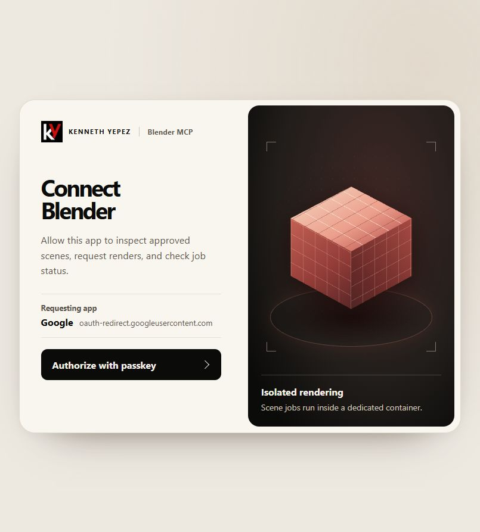
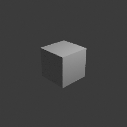
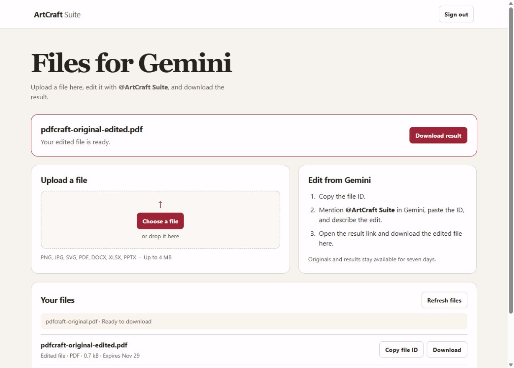

# Blender & ArtCraft MCP

Two Model Context Protocol integrations that turn Gemini requests into real Blender renders and native edits across 17 ArtCraft applications. Each job runs in an isolated container in a dedicated test environment.

**Kenneth Yepez · Engineering portfolio**

## The problem

A chat assistant can describe a creative edit, but delivering the result means opening the right application, working on the right input, and checking the exported file. Giving a remote assistant desktop or shell access would also put unrelated files and services within reach. With 17 editors, configuring a separate connector for each would add setup and make permissions harder to review.

The solution gives Gemini two purpose-built connectors. Blender accepts render and inspection requests for approved scenes. ArtCraft exposes one catalog for native creation and editing across the suite. A separate passkey-protected file portal lets users upload a document, ask Gemini to edit it by reference, and download the result.

| Workflow | Observed result |
| --- | --- |
| **Blender** | Gemini requested a render and checked its completion. The isolated Blender worker produced a **256 × 256 PNG**. |
| **ArtCraft Suite** | One connector exposed **53 creation and editing operations** across **17 apps**. A test batch verified **54 native steps** in 17 separate containers. A Gemini request separately ran two ordered WordCraft edits in one revision. |
| **Private files** | A synthetic PDF went through browser upload, a Gemini-triggered edit, and authenticated download. The first page rotated **90° clockwise** and retained its text. |

## Screenshots

### Blender authorization

The authorization screen presents the approved-scene workflow and asks the user to confirm access with a passkey.

The approved sample scene was also rendered again in an isolated local container using the published Blender task.

### ArtCraft file editing

The private portal shows a completed PDF edit and offers a separate download for the result. This capture contains only the synthetic acceptance-test files.

## Review the implementation

- [Architecture and security controls](docs/architecture.md) covers the trust boundaries, file handling, and trade-offs.
- [Acceptance evidence](docs/verification.md) records what was checked from Gemini, what ran in the container suite, and what reviewers can reproduce offline.
- [ArtCraft operation validation](review/artcraft/authoring.mjs) and [contract tests](review/artcraft/authoring.test.mjs) show how ordered requests are converted into a typed, bounded job payload.
- [Blender scene task](review/blender/blender-task.py) shows the native scene inspection and headless Cycles render code.

The public repository is a technical case study with selected implementation code and synthetic artifacts. It runs review checks locally without accounts or access to the private deployment.
