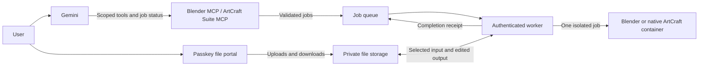

# Architecture and security controls

## Trust boundaries

| Boundary | Design |
| --- | --- |
| Human consent | WebAuthn passkeys authorize people. The portal and connector authorization use user verification and origin-bound challenges. |
| Gemini to gateway | OAuth authorization scopes access to the requested tools. The gateway accepts named operations with typed arguments and rejects requests outside the catalog. |
| Gateway to worker | Service authentication is separate from human sign-in. A queue keeps long-running jobs out of the interactive request and publishes their state separately. |
| Worker to application | Jobs run without network access, as an unprivileged user, with a read-only root filesystem, dropped capabilities, and resource limits. File jobs receive the selected input read-only and a dedicated writable output directory. |
| File data | The gateway checks ownership before scheduling an edit. The portal stores original and result separately and encrypts stored file bytes. Gemini handles the file reference, requested action, and status. An authenticated browser session retrieves the bytes. |

## Design decisions

**Constrain what the assistant can ask for.** Blender uses a fixed scene task and approved inputs. ArtCraft accepts one to four named operations per revision, validates each argument, and runs them in order. A revision commits after its operations pass their checks.

**Treat the app output as the acceptance signal.** Each editor has different evidence of success. Blender checks the render format and dimensions. ArtCraft compares native state before and after steps, and export tests inspect document properties and contents. In one successful PDF test, the assistant's final prose incorrectly said the edit could not run. The worker receipt and downloaded PDF established the outcome.

**Keep file workflows narrow.** The project workflow spans 17 apps. The separate upload workflow covers PNG/JPEG, SVG, PDF, DOCX, XLSX, and PPTX in six apps. JPEG inputs export as PNG. The portal applies upload and storage limits and a retention window.

These controls reduce the resources a job can reach. Containers share their host kernel, and app parsers still handle user-controlled files. The documented tests establish the behavior observed for the fixtures and controls exercised.

## Standards

- [Model Context Protocol authorization](https://modelcontextprotocol.io/specification/2025-11-25/basic/authorization)
- [Docker's none network driver](https://docs.docker.com/engine/network/drivers/none/)
- [Web Authentication](https://www.w3.org/TR/webauthn-3/)
